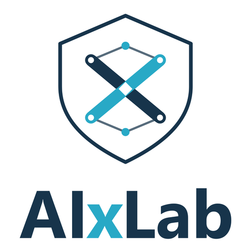

  

<h1 align="center">AIxLab · 爱可思实验室</h1>

Artificial Intelligence eXtended

陕西师范大学 · 人工智能与计算机学院

  <a href="https://snnuaixlab.github.io/aixlab/">实验室主页</a> ·
  <a href="https://snnuaixlab.github.io/aixlab/#publications">代表论文</a> ·
  <a href="https://snnuaixlab.github.io/aixlab/#join">加入我们</a>

我们以**人工智能安全**为主要研究方向，关注大模型、多模态与智能体应用中的安全与可信问题。

当智能应用从单个模型走向多方协作，模型需要调用外部信息，数据需要跨域流转，参与方也需要建立信任。我们围绕一个共同问题开展研究：**如何让智能在开放协作中安全、可信地运行？**

## 研究方向

| 方向 | 研究关注 |
| --- | --- |
| **人工智能安全** | 研究视觉、语言与多模态模型的安全性，探索大模型和智能体应用中的交互风险。 |
| **可信数据交互** | 研究跨链、多域环境下的数据交换与状态同步，关注数据来源、流转过程与使用约束的可验证性。 |
| **区块链可扩展性与安全** | 研究支付通道网络路由、跨分片交易处理等性能与安全问题，探索高效、可验证的协作机制。 |

三个方向围绕**模型安全、数据可信与高效协作**相互连接：人工智能安全提出应用需求，可信数据交互连接数据供给与智能应用，区块链系统研究提供可验证记录与协作机制方面的技术积累，共同支撑开放协作环境中的可信智能研究。

## 开源与实践

- **[aixlab](https://github.com/SNNUAIXLab/aixlab)**：实验室主页源码，展示研究动态、代表论文、团队与学习资料。
- **[NodeShell](https://github.com/AzureLandin/NodeShell)**：跨平台 SSH 与 Shell 工具，支持终端会话、SFTP 文件传输与远程主机管理。工具作者：[Qixin Xu（许齐鑫）](https://azurelandin.github.io/personal_CV/)。

欢迎对人工智能安全、多模态学习、数据安全或区块链方向感兴趣的同学交流与参与。
